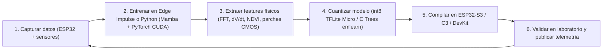

# 🧠 Inteligencia Artificial en el Borde (TinyML & Scientific ML) — Geofísica, Teledetección, Física Moderna y Ambiente
> **v2.0** (actualizado 21-10-2026) — Hoja de ruta de IA embebida (**TinyML** en ESP32) y **Machine Learning Científico** (PC con GPU CUDA / Mamba). Integra los proyectos originales (`IA-1` a `IA-5`) mejorados con los hallazgos experimentales del Proyecto 01 (compensación de *cross-talk* térmico `MQ-135` $\rightarrow$ `AHT20` y derivada dinámica $\text{d}V/\text{d}t$), más cuatro nuevos módulos para **Geofísica (ERT 2D)**, **Teledetección (`NDVI` activo + Visión)**, **Física Moderna (Muones relativistas en CMOS)** y **Agente de Voz / Robótica (`INMP441` + `MAX98357A` + `SG90`)**.

---

## Tabla de Contenidos
1. [Qué es TinyML y por qué aquí](#1-qué-es-tinyml-y-por-qué-aquí)
2. [Hardware disponible y su capacidad para IA](#2-hardware-disponible-y-su-capacidad-para-ia)
   - [2b. Checklist de hardware — ¿Qué falta?](#2b--checklist-de-hardware-para-ia--qué-falta)
3. [Herramientas de software](#3-herramientas-de-software)
4. [Proyecto IA-1: Clasificador sísmico (Sismo vs. Ruido urbano)](#4-proyecto-ia-1--clasificador-sísmico-sismo-vs-ruido)
5. [Proyecto IA-2: Nowcasting de lluvia local](#5-proyecto-ia-2--nowcasting-de-lluvia-local)
6. [Proyecto IA-3: Clasificador de cielo y radiometría (Visión)](#6-proyecto-ia-3--clasificador-de-cielo-visión)
7. [Proyecto IA-4: Detección acústica ambiental y Wake-Word (KWS)](#7-proyecto-ia-4--detección-acústica-ambiental)
8. [Proyecto IA-5: Anomalías ambientales, compensación térmica ML y firma de gases ($\text{d}V/\text{d}t$)](#8-proyecto-ia-5--detección-de-anomalías-ambientales-compensación-térmica-y-firma-de-gases)
9. [Proyecto IA-6: Geofísica — Inversión Neuronal ERT 2D y Clasificación del Subsuelo (PINNs / Surrogate RES2DINV)](#9-proyecto-ia-6--geofísica-inversión-neuronal-ert-2d-y-clasificación-del-subsuelo)
10. [Proyecto IA-7: Teledetección — Fusión Espectral `NDVI` Activo + Visión de Dosel Vegetal](#10-proyecto-ia-7--teledetección-fusión-espectral-ndvi-activo--visión-de-dosel-vegetal)
11. [Proyecto IA-8: Física Moderna — Clasificador de Trazas de Muones Cósmicos en CMOS (`OV2640`)](#11-proyecto-ia-8--física-moderna-clasificador-de-trazas-de-muones-cósmicos-en-cmos)
12. [Proyecto IA-9: Agente de Voz Interactiva y Telemetría Hablada (`INMP441` + `MAX98357A` + `SG90`)](#12-proyecto-ia-9--agente-de-voz-interactiva-y-telemetría-hablada)
13. [Flujo de trabajo general (Edge Impulse & Python Mamba/CUDA)](#13-flujo-de-trabajo-general-edge-impulse)
14. [Código base: captura de datos e inferencia](#14-código-base-captura-de-datos)
15. [Fases de implementación](#15-fases-de-implementación)
16. [Limitaciones y buenas prácticas](#16-limitaciones-y-buenas-prácticas)
17. [Recursos](#17-recursos)

---

## 1. Qué es TinyML y por qué aquí

**TinyML** = ejecutar modelos de Machine Learning (redes neuronales, árboles de decisión) directamente en microcontroladores de pocos mW.

| Enfoque | Dónde se procesa | Latencia | Internet | Privacidad | Costo mensual |
|---|---|:---:|:---:|:---:|:---:|
| IA en la nube (ChatGPT, APIs) | Servidor remoto | 0.5–3 s | Obligatorio | Datos salen de casa | Pago por uso |
| **TinyML (este proyecto)** | **El propio ESP32** | **1–100 ms** | **No necesario** | **Datos locales** | **\$0** |

> 💡 El objetivo **no** es reemplazar al CSN ni a un servicio meteorológico, sino que cada nodo **tome decisiones inteligentes por sí mismo**: filtrar falsas alarmas, anticipar lluvia, clasificar el cielo.

---

## 2. Hardware disponible y su capacidad para IA

### Microcontroladores

| Placa | Estado | CPU | PSRAM | Flash | Aceleración IA | Rol IA |
|---|:---:|---|:---:|:---:|:---:|---|
| **ESP32-S3 N16R8** (44 pines) | ✅ Comprada | Xtensa LX7 dual 240 MHz | **8 MB** | 16 MB | ✅ Instrucciones vectoriales (ESP-NN / ESP-DL) | **Cerebro IA principal** (sísmico, anomalías) |
| **XIAO ESP32-S3 Sense** | ✅ Comprada | Xtensa LX7 dual 240 MHz | 8 MB | 8 MB | ✅ Vectorial | **Visión + audio** (cámara + micrófono PDM integrados) |
| **ESP32 DevKit 30P** (WROOM-32) | ✅ Comprada | Xtensa LX6 dual 240 MHz | — | 4 MB | ❌ | Modelos pequeños (árboles, MLP chica) |
| **ESP32-C3 Super Mini** | ✅ Comprada | RISC-V single 160 MHz | — | 4 MB | ❌ | Árboles de decisión / umbrales aprendidos |

> ⚠️ Verificar la memoria exacta del XIAO al recibirlo (las versiones actuales traen 8 MB PSRAM + 8 MB Flash).

### Sensores útiles para IA

| Sensor | Dato que genera | Proyecto IA |
|---|---|---|
| **ADXL345** | Aceleración 3 ejes (series temporales) | IA-1 Sísmico |
| **MPU6050** | Aceleración + giroscopio | IA-1 (canal auxiliar), IA-5 |
| **AHT20 + BMP280** | Presión, temperatura, humedad | IA-2 Nowcasting, IA-5 |
| **BH1750** | Lux | IA-2, IA-5 |
| **MQ-135 + ADS1115** | Calidad del aire (señal analógica 16 bit) | IA-5 Anomalías |
| **PIR HC-SR501** | Presencia | IA-5 (contexto) |
| **Cámara OV2640/OV3660 (XIAO Sense)** | Imágenes | IA-3 Visión |
| **Micrófono PDM (XIAO Sense)** | Audio | IA-4 Acústica |

### Presupuesto de memoria típico (referencial)

| Tipo de modelo | Tamaño modelo (int8) | RAM de inferencia | Tiempo en ESP32-S3 |
|---|:---:|:---:|:---:|
| Árbol de decisión / Random Forest pequeño | 5–50 KB | < 5 KB | < 1 ms |
| Red densa (MLP) 2–3 capas | 10–50 KB | 5–20 KB | 1–5 ms |
| CNN 1D (series de acelerómetro) | 30–150 KB | 20–100 KB | 5–30 ms |
| Espectrograma + CNN 2D (audio) | 50–200 KB | 50–150 KB | 20–100 ms |
| Visión 96×96 (MobileNet / FOMO) | 100–300 KB | 200 KB–1 MB (PSRAM) | 100–500 ms |

> Los valores son órdenes de magnitud para planificar; Edge Impulse muestra el consumo real antes de desplegar.

---

## 2b. ✅ Checklist de hardware para IA — ¿Qué falta?

> Estado según lo conversado hasta ahora. **"Verificar"** = estaba en la lista del proyecto pero no se ha confirmado la compra.

### 🔴 Hardware Esencial (100% Comprado)

| Ítem | Para qué proyecto | Tienda | Estado | Notas |
|---|---|:---:|:---:|---|
| **ESP32-S3 N16R8** | IA-1 (Sismos), IA-5 (Anomalías), Audio | ML | ✅ Comprado | Cerebro principal con 8 MB PSRAM ($13.434) |
| **XIAO ESP32-S3 Sense** | IA-3 (Visión cielo), IA-4 (Acústica) | Mechatronic | ✅ Comprado | Cámara OV2640, micrófono PDM y ranura SD ($22.990) |
| **ADXL345 GY-291 (×2)** | IA-1 (Clasificador sísmico vs ruido) | Mechatronic | ✅ Comprado | Acelerómetros a alta velocidad SPI ($6.980 total) |
| **AHT20 + BMP280 (×3)** | IA-2 (Nowcasting lluvia), IA-5 | AFEL | ✅ Comprado | *Nota: Compradas 3 uds (Hub, Dormitorio y Exterior; el nodo remoto sísmico no lleva este sensor)* ($9.000) |
| **Sensor de Lluvia** | IA-2 (Etiquetador de lluvia real) | Mechatronic | ✅ Comprado | Genera las etiquetas supervisadas del modelo ($1.500) |
| **Módulos Lector MicroSD SPI (×2)** | Datasets CSV continuos en nodos | AFEL | ✅ Comprado | *Nota: Compradas 2 uds (sugerido inicial 3; XIAO ya trae ranura)* ($5.000) |
| **Tarjeta MicroSD Maxell 16GB** | Datasets de entrenamiento en FAT32 | ML | ✅ Comprado | *Nota: Comprada 1 ud inicial de 16GB (sugerido 3-4)* ($7.990) |
| **Xiaomi Cable USB-C de DATOS 1m** | Captura serial y programación en PC | ML | ✅ Comprado | *Nota: Comprado 1 cable datos de alta velocidad (sugerido 2-3)* ($6.990) |

### 🟡 Audio, Actuadores y Diálogo con IA (100% Comprado)

| Ítem | Para qué | Tienda | Estado | Notas |
|---|---|:---:|:---:|---|
| **Micrófono I2S INMP441** | IA-4 / Oído de DeepSeek (KWS) | AFEL | ✅ Comprado | Entrada de voz omnidireccional digital directa al S3 ($5.990) |
| **Amplificador I2S MAX98357A 3W** | Salida de voz humana (TTS) / Robot | ML | ✅ Comprado | DAC + Amplificador clase D digital sin pérdida ($5.890) |
| **Mini Parlante 3W 4Ω** | Boca del Robot / Alertas parlantes | AFEL | ✅ Comprado | Respuesta acústica de alta fidelidad ($3.000) |
| **Micro Servomotores SG90 (×2)** | Paneo cámara / Patas robot mascota | AFEL | ✅ Comprado | Servos de posición angular analógica ($3.980) |
| **Potenciómetros WH148 B10K (×3)** | Calibración manual de sensibilidad IA | AFEL | ✅ Comprado | *✅ Compradas 3 uds (sugerido inicial 2)* ($1.500) |
| **Buzzer Pasivo Solo (×2)** | Alarmas sonoras de emergencia | AFEL | ✅ Comprado | Alarma local piezoeléctrica ($600) |
| **MQ-135 + ADS1115** | IA-5 (Detección anomalías de aire) | AFEL | ✅ Comprado | Lectura de gas con resolución 16-bit ($11.800) |
| **BH1750 (×2)** | IA-2 / Luz para inferencia de nubes | Mechatronic | ✅ Comprado | *Nota: Compradas 2 uds (sugerido inicial 3)* ($7.980) |
| **Radar Microondas RCWL-0516** | Detección de presencia invisible | Mechatronic | ✅ Comprado | Despierta al robot o nodo al acercarse ($2.290) |
| **Infrarrojo HW-201 + Ultrasonido HC-SR04** | Detección obstáculos y distancia robot | Mech / AFEL | ✅ Comprado | Navegación y proximidad ($2.990 total) |
| **Maletín Organizador Plástico** | Almacenamiento seguro de componentes | ML | ✅ Comprado | Caja con compartimientos transparente ($5.661) |

### 🔶 Pendientes de compra (conciliado con facturas, 10-10-2026)

| Ítem | Para qué | Notas |
|---|---|---|
| **Pantalla TFT ST7789** | Espectrograma FFT / dashboard del Hub | Requerida por el proyecto geofísico (no por la IA) |
| **MicroSD 16-32GB ×2** | Datasets del nodo remoto y del XIAO | La Maxell comprada va en el Hub |
| *(Opcional)* **BH1750 ×1** | Luz en el Dormitorio | Solo hay 2 (Hub y Exterior) |

### 🟢 Opcional para fases futuras (cuando se expanda la instalación)

| Ítem | Para qué | Notas |
|---|---|---|
| **Más tarjetas MicroSD 16-32GB** | Expandir logging simultáneo a todos los nodos satélite | Reutilizar la tarjeta Maxell en el Hub para partir |
| **Lector MicroSD USB para PC** | Si tu PC no tiene ranura MicroSD o lector multitarjeta | Barato en retail o ferretería (~$2.000) |
| **Base rígida baldosa para sismógrafo** | Fijar el ADXL345 sólidamente al piso | Retazo de baldosa + silicona |
| **Caja estanca IP65** | Para dejar el nodo exterior en el patio definitivo | Instalar tras probar en interiores |

### 💻 Software / PC (sin costo — $0)

| Ítem | Notas |
|---|---|
| Cuenta en **Edge Impulse** | Plan gratuito para desarrolladores; entrena en la nube (**no necesitas GPU**) |
| **Node.js** + `edge-impulse-cli` | Para el data forwarder directo por puerto USB |
| **Arduino IDE 2.x** + soporte ESP32 (Espressif) | Compilar sketches, librerías y modelos exportados |
| **Python 3 + Jupyter + scikit-learn + pandas** | Para IA-2 y IA-5 con datasets descargados en CSV |
| **API de DeepSeek / OpenAI** | Para conectar el ESP32-S3 por WiFi y dialogar por voz con el robot |

### 💰 Inversión Real Consolidada en Hardware

| Tienda | Monto Pagado | Cobertura |
|---|:---:|---|
| **Mercado Libre** | **$130.039 CLP** | Microcontroladores, herramientas pro, cable Xiaomi, MicroSD Maxell, maletín y MAX98357A |
| **MechatronicStore** | **$70.760 CLP** | XIAO ESP32-S3 Sense, sensores sísmicos, BH1750, lluvia, radar RCWL-0516, HW-201, láser, protoboards, flux, alcohol, pinzas |
| **AFEL** | **$92.970 CLP** | Sensores AHT20+BMP280, MQ-135, audio (INMP441 + parlante), servos, kit básico, cables ($88.970 productos + $4.000 envío) |
| **TOTAL GENERAL** | **$293.769 CLP** | **Comprado, salvo los pendientes indicados arriba (TFT, 2× MicroSD).** |

---

## 3. Herramientas de software

| Herramienta | Para qué | Dificultad | Recomendación |
|---|---|:---:|---|
| **[Edge Impulse](https://edgeimpulse.com)** | Captura, etiquetado, entrenamiento y exportación como librería Arduino | ⭐ Baja | **Empezar aquí** (plan gratuito para desarrolladores) |
| **TensorFlow Lite Micro / LiteRT for Microcontrollers** | Framework de Google para correr redes en MCU | ⭐⭐⭐ Media-alta | Fase avanzada |
| **ESP-NN** | Kernels optimizados de Espressif para TFLite Micro en ESP32-S3 | ⭐⭐ | Se usa automáticamente vía librerías |
| **ESP-DL** | Librería de deep learning de Espressif (visión, detección de rostros) | ⭐⭐⭐ | Para IA-3 avanzado |
| **Python + scikit-learn + Jupyter** | Análisis de datos de la MicroSD y entrenamiento de árboles | ⭐⭐ | IA-2 / IA-5 |
| **micromlgen / m2cgen / emlearn** | Convierte modelos scikit-learn a código C para Arduino | ⭐⭐ | Para ESP32 clásico y C3 |

---

## 4. Proyecto IA-1 — Clasificador sísmico (sismo vs ruido)

### Problema
El algoritmo STA/LTA (ver documento principal) dispara con **cualquier** vibración fuerte: camiones, portazos, pasos, lavadora. Resultado: muchas falsas alarmas.

### Solución
Un modelo que analiza la **forma de la señal** en una ventana de tiempo y clasifica el origen.

```text
ADXL345 (100–200 Hz) ──► Ventana 2 s ──► Extracción espectral ──► Red neuronal ──► Clase + probabilidad
                                         (FFT / bandas)          (MLP o CNN 1D)
                    STA/LTA dispara ─────────────────────────────────┘ (solo se infiere tras un disparo)
```

### Clases propuestas

| Clase | Cómo obtener ejemplos |
|---|---|
| `quieto` | Grabar la estación en reposo (noche) |
| `pasos` | Caminar cerca de la estación |
| `golpe` | Portazos, golpes en la mesa/suelo |
| `trafico` | Grabar en horario de tráfico pesado |
| `maquina` | Lavadora, bomba de agua, refrigerador |
| `sismo` | Sismos reales registrados + **mesa vibratoria casera** (ver nota) |

> ⚠️ **El reto es la clase `sismo`**: hay pocos ejemplos propios. Estrategias:
> 1. Registrar los sismos reales que ocurran (en Chile son frecuentes) y **confirmarlos con el catálogo del CSN**.
> 2. Descargar registros de aceleración de bases públicas (IRIS, CSN) y **reescalarlos/remuestrearlos** al formato del ADXL345.
> 3. Simular ondas de baja frecuencia (1–10 Hz) con una plataforma oscilante manual.

### Características (features) recomendadas
- Energía por bandas de frecuencia: 0.5–2 Hz, 2–5 Hz, 5–10 Hz, 10–20 Hz, 20–50 Hz
- Duración del evento (s)
- Relación entre ejes: vertical vs horizontal (las ondas P son más verticales)
- Pico de aceleración (PGA) y RMS

### Modelo
- **Inicio:** bloque *Spectral Analysis* de Edge Impulse + red densa (MLP) → simple y muy rápida.
- **Avanzado:** CNN 1D sobre la señal cruda en el ESP32-S3 (usa PSRAM).

### Integración con el sistema
```text
if STA/LTA > umbral:
    clase, p = modelo(ventana_2s)
    if clase == "sismo" and p > 0.85:
        → MQTT geofisica/eventos {tipo:"sismo", p, pga, duracion}
        → Telegram alerta
    else:
        → log en MicroSD como "falsa_alarma" (sirve para reentrenar)
```

### Validación científica
Comparar durante semanas: **eventos detectados por la IA vs catálogo del CSN** → calcular precisión, recall y matriz de confusión.

---

## 5. Proyecto IA-2 — Nowcasting de lluvia local

### Problema
El pronóstico de la ciudad no describe lo que pasa en tu techo en las próximas horas.

### Solución
Con el histórico de la MicroSD, entrenar un modelo que estime **probabilidad de lluvia en las próximas 3 h**.

| Entrada (features) | Fuente |
|---|---|
| Presión actual (hPa) | BMP280 |
| Tendencia de presión $\Delta P_{1h}$, $\Delta P_{3h}$ | BMP280 (calculado) |
| Humedad relativa y su tendencia | AHT20 |
| Punto de rocío y diferencia temp − rocío | Calculado |
| Lux (nubosidad diurna) | BH1750 |
| Hora del día, mes (codificados sin/cos) | RTC / NTP |
| **Etiqueta**: ¿llovió en las siguientes 3 h? | **Sensor de lluvia** del nodo exterior |

Punto de rocío (aproximación de Magnus):

$$T_d = \frac{b\,\gamma}{a - \gamma}, \qquad \gamma = \ln\!\left(\frac{HR}{100}\right) + \frac{a\,T}{b + T}, \quad a = 17.62,\; b = 243.12\,^\circ\text{C}$$

### Modelo
- **Random Forest** o **árbol de decisión** en scikit-learn → exportado a C con `micromlgen` o `emlearn`.
- Corre incluso en el **ESP32-C3** del nodo exterior.

### Requisito clave
> ⏳ Necesita **datos acumulados**: idealmente **3–6 meses** de registros incluyendo días de lluvia. Empezar a guardar datos desde la Fase 1 aunque el modelo se entrene después.

---

## 6. Proyecto IA-3 — Clasificador de cielo (visión)

### Hardware
**XIAO ESP32-S3 Sense** (cámara + MicroSD integrada), apuntando al cielo.

### Clases

| Clase | Descripción |
|---|---|
| `despejado` | Cielo azul sin nubes |
| `parcial` | Nubes dispersas |
| `cubierto` | Cielo totalmente nublado |
| `noche` | Baja luminosidad |
| `lluvia_niebla` | Gotas en el lente / visibilidad reducida |

### Flujo
```text
Foto horaria (JPG) ──► MicroSD (dataset) ──► Etiquetado en Edge Impulse ──► Modelo 96×96
         │                                                                      │
         └──────────────── en producción ──► Inferencia local ──► MQTT cielo/estado {clase, p}
```

### Valor científico
- Correlacionar **clase de cielo** con **lux (BH1750)** y **presión (BMP280)**.
- Alimentar al modelo IA-2 como feature adicional (`cobertura_nubosa`).

> 💡 Proteger la cámara con una cúpula transparente y considerar el sol directo (puede saturar el sensor).

---

## 7. Proyecto IA-4 — Detección acústica ambiental

### Hardware
Micrófono PDM integrado del **XIAO ESP32-S3 Sense**.

### Clases posibles
| Clase | Aplicación |
|---|---|
| `lluvia` | Confirmación acústica de lluvia en techo (redundancia del sensor de lluvia) |
| `viento_fuerte` | Alertas de viento |
| `ladrido` / `voz` | Contexto de actividad (sin grabar contenido) |
| `alarma` | Detectar alarmas de humo o sirenas |
| `silencio` / `fondo` | Clase base obligatoria |

### Técnica
Audio 16 kHz → ventanas de 1 s → **MFE / espectrograma Mel** → CNN 2D pequeña.

> 🔒 **Privacidad:** el audio se procesa en memoria y se descarta; solo se publica la clase detectada.

---

## 8. Proyecto IA-5 — Detección de anomalías ambientales, compensación térmica y firma de gases

### Idea (Mejorada con hallazgos del Proyecto 01)
En vez de depender de umbrales fijos (`CO₂ > 1000 ppm`), el sistema **aprende el perfil multivariable normal** de la habitación y resuelve **tres problemas físicos reales** que descubrimos en el laboratorio durante la puesta en marcha del Proyecto 01:

1. **Compensación por ML del *Cross-Talk* Térmico (`MQ-135` $\rightarrow$ `AHT20`):**
   - **Hallazgo experimental:** El calefactor interno de $5\text{ V}$ ($\sim 150\text{ mA}$) del `MQ-135` irradia calor en la protoboard y eleva la lectura del `AHT20` en **$+1.0\text{ }^\circ\text{C}$** (`20.8 °C` $\rightarrow$ `21.8 °C`) con una constante de tiempo térmica $\tau \approx 4\text{ min}$.
   - **Solución ML:** Entrenar un modelo de regresión ligero (o filtro de estado térmico en C) que estime la temperatura ambiente verdadera $T_{\text{true}}$ en función del tiempo de encendido $t_{\text{on}}$, la diferencia $T_{\text{AHT20}} - T_{\text{BMP280}}$ y la humedad relativa $RH$.
2. **Corrección Termo-Higrométrica de la línea base $R_s/R_0$ del `MQ-135`:**
   - La resistencia del dióxido de estaño ($\text{SnO}_2$) depende no linealmente de $T$ y $RH$:
     $$\left(\frac{R_s}{R_0}\right)_{\text{corr}} = \frac{R_s / R_0}{c_0 + c_1 T + c_2 RH + c_3 T\cdot RH}$$
   - Un perceptrón multicapa (MLP) de $3 \rightarrow 8 \rightarrow 1$ ajusta dinámicamente la línea base sin falsas alarmas cuando cambia el clima diario.
3. **Clasificación Dinámica de Plumas de Gas mediante la derivada $\text{d}V/\text{d}t$:**
   - Durante la prueba con gas butano del encendedor vimos que el voltaje salta de `0.28 V` a `0.98 V` en $< 2\text{ s}$ y decae exponencialmente en $\sim 12\text{ s}$, mientras que el $\text{CO}_2$ metabólico humano en un dormitorio cerrado sube lentamente ($\text{d}V/\text{d}t \approx 0.002\text{ V/min}$).

| Clase / Anomalía | Firma en vector de features $[V, \text{d}V/\text{d}t, \text{d}^2V/\text{d}t^2, \Delta T, \Delta RH]$ |
|---|---|
| `aire_limpio` | $V \approx 0.28\text{ V}$ estable, $\text{d}V/\text{d}t \approx 0$ |
| `fuga_gas_butano` | Subida abrupta ($\text{d}V/\text{d}t > +0.3\text{ V/s}$) + decaimiento rápido sin cambio de $RH$ |
| `cov_alcohol_humo` | Subida media + cola de recuperación larga ($\tau_{\text{decay}} > 45\text{ s}$) |
| `co2_acumulado` | Pendiente positiva lenta y sostenida + aumento gradual de $T$ y $RH$ (`PIR = 1`) |
| `ventana_abierta` | Caída rápida de $T$, caída de $V_{\text{MQ135}}$ y cambio brusco de $RH$ |

### Técnica
- **Autoencoder / K-means** (bloque *Anomaly Detection* de Edge Impulse) + **Random Forest / MLP** sobre ventanas deslizantes de $30\text{ s}$.

---

## 9. Proyecto IA-6 — Geofísica: Inversión Neuronal ERT 2D y Clasificación del Subsuelo

### El Problema Geofísico
En el **Proyecto 02 (Tomografía de Resistividad Eléctrica 2D — Wenner / Schlumberger)** medimos una **pseudosección de resistividad aparente** $\rho_a(x, a)$ usando 4 electrodos, inyección bipolar (`D25`/`D26`) y el ADC diferencial de 16 bits `ADS1115`.
La inversión clásica tipo **`RES2DINV` / `pyGIMLi`** resuelve iterativamente matrices jacobianas de diferencias/elementos finitos en PC. Sin embargo, podemos usar **Machine Learning Científico (PINNs / Surrogate Inversion)** tanto en el PC (con tu GPU CUDA en el entorno Mamba) como en el propio `ESP32-S3`.

### Arquitectura Dual (PC CUDA + Edge ESP32-S3)

1. **En el ESP32-S3 (Edge TinyML — Diagnóstico instantáneo en terreno):**
   - **Entrada:** Vector de $N$ mediciones de resistividad aparente normalizada $\log_{10}(\rho_a)$ de una línea Wenner (ej. 10 a 15 cuadripolos) + impedancia de contacto de electrodos.
   - **Modelo TinyML (`MLP` / `1D-CNN` cuantizado `int8`):**
     - **Clasificador de calidad de contacto:** Detecta automáticamente si un electrodo tiene mal contacto galvánico o polarización parásita antes de guardar el `.dat`.
     - **Clasificador rápido de anomalías del subsuelo:** Clasifica el perfil en tiempo real en la pantalla OLED:
       - `medio_homogeneo` (estratificación suave)
       - `bulbo_humedad_conductivo` (anomalía cerrada de baja $\rho$, ej. infiltración de agua)
       - `cavidad_o_roca_resistiva` (anomalía de alta $\rho$, ej. piedra enterrada o hueco seco)
       - `nivel_freatico_somero` (transición vertical conductiva)
2. **En el PC con GPU CUDA (Surrogate Neural Inversion / PINN):**
   - Generamos $10\,000$ modelos sintéticos 2D en Python con **`pyGIMLi`** (capas, bloques conductivos/resistivos, gradientes de humedad) y calculamos sus pseudosecciones Wenner hacia adelante (*forward modeling*).
   - Entrenamos una red neuronal en **PyTorch (CUDA)** ($\rho_a(x,a) \xrightarrow{\text{NN}} \rho_{\text{true}}(x,z)$) que invierte una pseudosección 2D en **$< 5\text{ ms}$**, permitiendo comparar la inversión neuronal frente a la inversión de Gauss-Newton de `RES2DINV` / `ResIPy`.

---

## 10. Proyecto IA-7 — Teledetección: Fusión Espectral `NDVI` Activo + Visión de Dosel Vegetal

### El Problema Geomático / Radiométrico
En el **Proyecto 04 (`NDVI` Proximal Activo)** medimos reflectancia en **Rojo ($625\text{ nm}$)** e **Infrarrojo Cercano ($\text{NIR } 940\text{ nm}$)** mediante modulación síncrona (`On - Off`) leída con el `ADS1115` de 16 bits.
En teledetección real, el índice $\text{NDVI} = \frac{\rho_{\text{NIR}} - \rho_{\text{Red}}}{\rho_{\text{NIR}} + \rho_{\text{Red}}}$ sufre variaciones por **geometría de iluminación (BRDF)**, sombras proyectadas, humedad superficial de la hoja y porcentaje de suelo desnudo en el campo de visión (*FOV*).

### Fusión Multimodal con TinyML
Combinamos el **espectrómetro puntual (`Red + NIR + ADS1115`)**, el luxómetro **`BH1750`** y la cámara **`OV2640` (`XIAO ESP32-S3 Sense`)**:

- **Vector de Entrada:**
  $$\mathbf{x} = \left[\rho_{\text{Red}},\; \rho_{\text{NIR}},\; \text{NDVI},\; \text{SAVI},\; E_{\text{lux}},\; T_{\text{hoja/aire}},\; RH,\; \text{RGB}_{\text{canopy\_histogram}}\right]$$
- **Clases de Salida (Random Forest / MLP embebido):**
  1. `vegetacion_vigorosa_hidratada` (alta absorción en $625\text{ nm}$, alta dispersión celular en $940\text{ nm}$)
  2. `estres_hidrico_temprano` (caída sutil en NIR + aumento de relación Rojo/Verde antes del amarillamiento visible)
  3. `vegetacion_senescente_seca` (baja clorofila, $\text{NDVI} < 0.35$)
  4. `suelo_desnudo_seco` vs. `suelo_desnudo_humedo`
  5. `agua_o_sombra` ($\text{NDVI} \le 0$)

---

## 11. Proyecto IA-8 — Física Moderna: Clasificador de Trazas de Muones Cósmicos en CMOS

### El Problema en Física de Partículas / Relatividad Especial
En el **Proyecto 05 (Detector de Muones Cósmicos Relativistas $\mu^\pm$, dilatación temporal $\tau = \gamma\tau_0$)** usamos el sensor CMOS **`OV2640`** del `XIAO ESP32-S3 Sense` cubierto con cinta negra aislante y lámina de aluminio (o fotodiodos PIN en coincidencia).
Cuando un cuadro oscuro (*dark frame*) supera el umbral de brillo en unos pocos píxeles, el evento puede deberse a:
1. **Ruido térmico / *Hot pixels* fijos** del sensor CMOS.
2. **Fluctuación electrónica de lectura** en filas/columnas.
3. **Impacto real de partícula ionizante** (muón cósmico secundario o electrón Compton de radiación ambiental).

### Clasificador de Parches $16 \times 16$ en el Borde (`XIAO ESP32-S3 Sense`)
Cada vez que el algoritmo de disparo rápido detecta un píxel con intensidad $I(x,y) > \mu_{\text{dark}} + 6\sigma$, extrae un recorte (**patch de $16 \times 16$ píxeles**) alrededor del máximo y lo pasa por una **CNN ultraligera / clasificador morfológico en el ESP32-S3**:

| Clase | Morfología en el parche $16 \times 16$ | Significado físico |
|---|---|---|
| `hot_pixel_ruido` | 1 solo píxel aislado sin halo vecino, o coordenada recurrente $(x_0, y_0)$ en el mapa de máscara | Corriente oscura térmica del silicio (descartar) |
| `impacto_puntual_vertical` | Clúster simétrico Gaussiano de $2\times 2$ a $4\times 4$ píxeles con difusión de carga a píxeles adyacentes | Muón incidente casi perpendicular al plano del CMOS ($\theta \approx 0^\circ$) |
| `traza_oblicua_muon` | Traza lineal alargada (*streak* de $4\text{ a }12$ píxeles) con perfil de energía depositada $\text{d}E/\text{d}x$ | Muón relativista rasante o electrón secundario de alta energía |
| `artefacto_cmos` | Línea horizontal/vertical completa o saturación de bloque | Ruido de bus de cámara (descartar) |

- **Valor para el Diplomado en Física Moderna:** Permite construir un **histograma limpio de tasas de conteo por minuto (CPM)** y distribución angular $\cos^2\theta$ libre de falsos positivos térmicos, además de verificar el ajuste estadístico de **Poisson** $P(k) = \frac{\lambda^k e^{-\lambda}}{k!}$.

---

## 12. Proyecto IA-9 — Agente de Voz Interactiva y Telemetría Hablada

### Hardware (100% en tu inventario)
- **Oído digital:** Micrófono omnidireccional **`INMP441` (I2S)** o micrófono PDM del `XIAO ESP32-S3 Sense`.
- **Voz digital:** Amplificador clase D **`MAX98357A` (I2S, 3 W)** + **Parlante de $3\text{ W } 4\text{ }\Omega$**.
- **Expresión física / Paneo:** 2× Micro servomotores **`SG90`** + Radar Doppler de presencia **`RCWL-0516`**.
- **Cerebro:** **`ESP32-S3 N16R8`** (8 MB PSRAM, aceleración vectorial `ESP-NN` / `ESP-SR`).

### Flujo Híbrido (TinyML Wake-Word Local + LLM / Telemetría Local)
```text
[Radar RCWL-0516 detecta presencia]
        │
        ▼
[INMP441 I2S 16 kHz] ──► TinyML Wake-Word / Keyword Spotting en ESP32-S3 (< 30 ms, sin internet)
        │                Comandos locales: "estado", "temperatura", "aire", "sismo", "alerta"
        ├──► Respuesta Instantánea Offline (WAV/TTS local por MAX98357A):
        │    "Temperatura 20.8 grados, calidad del aire buena, 418 ppm."
        └──► Consulta Científica Opcional (Wi-Fi -> API DeepSeek / LLM local en PC por Wi-Fi):
             Explicación hablada de anomalías barométricas, inversión ERT o estado sísmico.
```

---

## 13. Flujo de trabajo general (Edge Impulse & Python Mamba/CUDA)



### Dos rutas complementarias de entrenamiento
1. **Ruta A — Edge Impulse (rápida para Audio `IA-4`/`IA-9`, Visión `IA-3` y Acelerómetro `IA-1`):**
   - Subir datos con `edge-impulse-data-forwarder` o archivos CSV/JPG desde la MicroSD.
   - Diseñar el impulso (*Spectral Analysis* / *MFE* / *Image*) y exportar como **Librería Arduino cuantizada (`int8`)**.
2. **Ruta B — Tu entorno local Python Mamba + GPU CUDA (ideal para `IA-2`, `IA-5`, `IA-6` ERT, `IA-7` NDVI e `IA-8` Muones):**
   - Entrenar modelos `scikit-learn` (`RandomForest`, `IsolationForest`, `MLP`) o `PyTorch` en tu PC usando el entorno documentado en `04_mamba_cuda_esp32_setup.md`.
   - Exportar árboles de decisión directamente a un archivo cabecera `.h` en C puro sin dependencias usando **`emlearn`** o **`micromlgen`** (corre en $< 1\text{ ms}$ incluso en el `ESP32-C3 Super Mini`), o redes `TFLite Micro` para el `ESP32-S3 N16R8`.

---

## 14. Código base: captura de datos

### 14.1 Captura del ADXL345 para Edge Impulse (data forwarder)

```cpp
// Captura ADXL345 a frecuencia fija para edge-impulse-data-forwarder
// Placa: ESP32-S3 N16R8 | Librerías: Adafruit ADXL345, Adafruit Unified Sensor
#include <SPI.h>
#include <Adafruit_Sensor.h>
#include <Adafruit_ADXL345_U.h>

#define FREQ_HZ      100                      // 100 Hz cubre la banda sísmica útil (< 50 Hz)
#define INTERVAL_US  (1000000UL / FREQ_HZ)

#define PIN_SCK  12
#define PIN_MISO 13
#define PIN_MOSI 11
#define PIN_CS   10

Adafruit_ADXL345_Unified accel(PIN_SCK, PIN_MISO, PIN_MOSI, PIN_CS, 12345);

void setup() {
  Serial.begin(115200);
  if (!accel.begin()) {
    Serial.println("ERROR: ADXL345 not detected");
    while (true) delay(1000);
  }
  accel.setRange(ADXL345_RANGE_2_G);          // Max sensitivity for micro-vibrations
  accel.setDataRate(ADXL345_DATARATE_200_HZ); // Sensor ODR > sampling frequency
}

void loop() {
  static uint32_t last = micros();
  if (micros() - last >= INTERVAL_US) {
    last += INTERVAL_US;
    sensors_event_t e;
    accel.getEvent(&e);
    Serial.printf("%.4f,%.4f,%.4f\n", e.acceleration.x, e.acceleration.y, e.acceleration.z);
  }
}
```

### 14.2 Registro ambiental y derivada de gas para entrenamiento (`IA-2` / `IA-5`)

```text
Archivo: /ia/env_dataset_YYYYMMDD.csv  (cada 5 s para capturar plumas transitorias de gas)
timestamp,temp_aht_C,temp_bmp_C,hum_pct,press_hPa,slp_hPa,mq135_volts,dv_dt_volts_s,rain_label
2026-10-21T15:30:00,20.80,21.10,59.4,957.9,1019.9,0.280,0.000,0
```

### 14.3 Esqueleto de inferencia en C/C++ (Edge Impulse / TFLite)

```cpp
#include <your_project_inferencing.h>   // Header generated by Edge Impulse

float buffer[EI_CLASSIFIER_DSP_INPUT_FRAME_SIZE];

void runInference() {
  signal_t signal;
  numpy::signal_from_buffer(buffer, EI_CLASSIFIER_DSP_INPUT_FRAME_SIZE, &signal);
  ei_impulse_result_t result;
  if (run_classifier(&signal, &result, false) != EI_IMPULSE_OK) return;

  for (size_t i = 0; i < EI_CLASSIFIER_LABEL_COUNT; i++) {
    Serial.printf("%s: %.2f\n", result.classification[i].label, result.classification[i].value);
  }
}
```

---

## 15. Fases de implementación

```text
FASE IA-0 — Integrada al Proyecto 01 (Actual)
  ├── Registro serie/CSV de AHT20 + BMP280 + MQ-135 (V y dV/dt)
  └── Modelo de compensación térmica del calefactor MQ-135 y clasificador de plumas de gas (IA-5)

FASE IA-1 — Geofísica y Sismología (Proyectos 02 y 06)
  ├── IA-6: Generador de modelos sintéticos en pyGIMLi + Red Neuronal de inversión ERT 2D (CUDA)
  ├── IA-6 (Edge): Clasificador de anomalías resistivas/conductivas en pseudosección Wenner
  └── IA-1: Clasificador sísmico STA/LTA + MLP (sismo vs. ruido urbano en ADXL345)

FASE IA-2 — Teledetección y Meteorología (Proyectos 01 y 04)
  ├── IA-7: Fusión espectral NDVI activo (625 nm / 940 nm) + luxómetro BH1750 + visión OV2640
  ├── IA-3: Clasificador de cobertura nubosa 96×96 en XIAO ESP32-S3 Sense
  └── IA-2: Nowcasting barométrico de lluvia local (Random Forest en C con emlearn)

FASE IA-3 — Física Moderna y Agente de Voz (Proyectos 05 y Audio I2S)
  ├── IA-8: Clasificador de parches CMOS 16×16 para separar trazas de muones cósmicos de hot pixels
  └── IA-4 / IA-9: Detección acústica ambiental + Asistente de voz I2S (INMP441 + MAX98357A + SG90)
```

---

## 16. Limitaciones y buenas prácticas

| ⚠️ Limitación | Mitigación |
|---|---|
| *Cross-talk* térmico del `MQ-135` sobre el `AHT20` ($+1.0\text{ }^\circ\text{C}$) | Separación física en protoboard (OLED como escudo térmico en mini breadboard) + compensación por regresión usando $t_{\text{on}}$ y $\Delta T$ |
| Zona muerta del ADC del ESP32 clásico bajo $142\text{ mV}$ | Configurar atenuación `ADC_2_5db` en `PIN_MQ135` o usar el ADC de 16 bits `ADS1115` |
| No-unicidad en la inversión geofísica ERT (`IA-6`) | Regularización física en la función de pérdida (PINNs) y validación cruzada contra `RES2DINV` / `pyGIMLi` |
| *Hot pixels* térmicos en el sensor CMOS `OV2640` (`IA-8`) | Calibrar mapa maestro de *dark frame* inicial + clasificar morfología del clúster $16\times 16$ |
| Modelos grandes no caben en `ESP32 DevKit` / `C3` | Desplegar árboles (`emlearn`) o MLP pequeñas en `C3`/`DevKit`, y CNNs/Audio/Visión en `ESP32-S3 N16R8` y `XIAO S3 Sense` |

---

## 17. Recursos

- 📘 [Edge Impulse — Documentación](https://docs.edgeimpulse.com)
- 📘 [Seeed Studio — XIAO ESP32-S3 Sense Wiki](https://wiki.seeedstudio.com/xiao_esp32s3_getting_started/)
- 📘 [Espressif ESP-DL](https://github.com/espressif/esp-dl) · [ESP-NN](https://github.com/espressif/esp-nn) · [ESP-SR (Speech Recognition)](https://github.com/espressif/esp-sr)
- 📘 [emlearn — Random Forest / ML en C para microcontroladores](https://github.com/emlearn/emlearn)
- 📘 [pyGIMLi — Geophysical Inversion and Modelling Library](https://www.pygimli.org/)
- 📘 [ResIPy — Open-source Geoelectrical Inversion (GUI & Python API)](https://gitlab.com/hkex/resipy)
- 🌐 [CSN Chile — Catálogo sísmico](https://www.csn.uchile.cl/sismicidad/catalogo-sismico/) (validación `IA-1`)

---

> **v2.0** — Documento de IA embebida (TinyML) y Machine Learning Científico, actualizado el 21-10-2026. Nueve proyectos de IA (`IA-1` a `IA-9`) integrados con las líneas de Ambiental, Geofísica (ERT 2D + Sísmica), Teledetección (`NDVI` + Visión) y Física Moderna (Muones relativistas).
